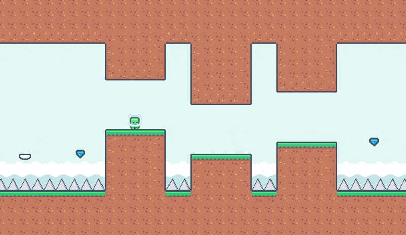
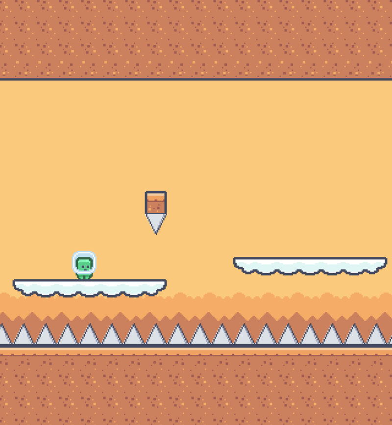
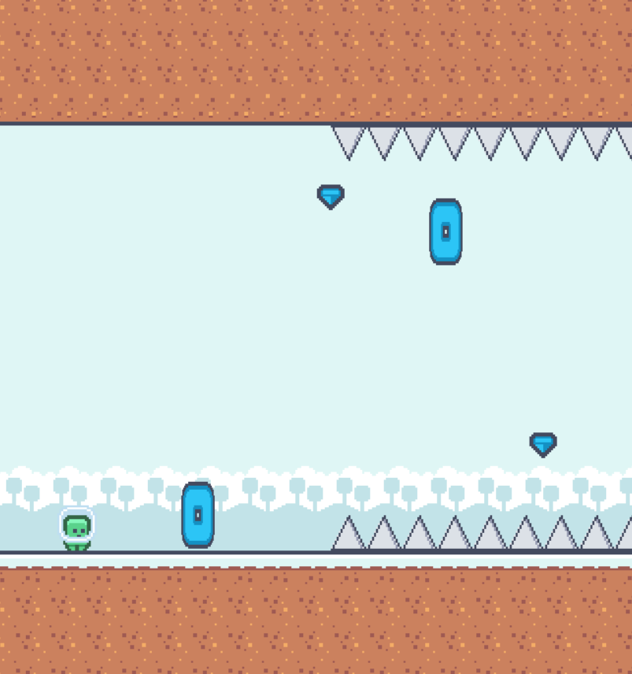

# Geometry Dash Clone

2D platformer in Python with Pygame, inspired by Geometry Dash. The player runs to the right on their own and has to jump over spikes, flip gravity through portals and reach the finish flag. Every level is a plain text file, so new levels can be made in any text editor.


## Features

- Three levels, each with its own theme (grass, sand, snow) and music
- Gravity portals that turn the player upside down, so the ceiling becomes the floor
- Speed portals that make the level faster or slower
- Jump orbs that give one more jump in the air
- Collision between the player and the spikes, so that they kill the player when they are touched
- Platforms choose their image on their own depending on the platforms next to them
- Attempt counter 
- The level and the music start over after every death


## Example








## Running

Requires Python 3.10 or newer.

```bash
python -m venv venv
venv\Scripts\activate
pip install -r requirements.txt
python main.py
```

On Linux or macOS, activate the virtual environment with `source venv/bin/activate` instead.


## Controls

- `Space`: jump; hold it to jump again as soon as the player lands
- `Space` while touching a jump orb: jump in the air
- `Esc`: back to the previous menu


## Level format

Every level is a folder in `assets/levels`, named `level1`, `level2` and so on. The folder holds:

- `.txt` file with the map of the level
- `.mp3` file with the music
- `.png` file with the picture shown in the level menu
- `tiles` folder with the images of the ground, the clouds and the background


In the `.txt` file every character is one tile:

- `#`: platform
- `C`: cloud platform
- `B`: start position of the player
- `F`: finish flag
- `^`: spike
- `v`: spike on the ceiling
- `P`: gravity portal
- `S`: portal that makes the level faster
- `D`: portal that makes the level slower
- `J`: jump orb
- `M`: the attempt counter

To add a new level, create a folder `assets/levels/level4` with the same files.


## Project structure

```
main.py                 entry point
src/
    constants.py        screen size, physics settings and folders
    menu.py             main menu and level selection
    game_loop.py        the loop that runs one level
    game.py             loading a level, the camera, drawing the world
    ball.py             the player
    level_object.py     base class for every object in the level
    tile.py             platforms and clouds
    spike.py            spikes and the collision between the player and a spike
    gravity_portal.py   gravity portal
    speed_portal.py     speed portal
    jump_orb.py         jump orb
    finish_line.py      finish flag
    message.py          text inside the level
    sprites.py          loading the images and choosing the image of every platform
assets/
    levels/             one folder for every level
    menu/               menu buttons and backgrounds
    shared/             images used in every level
tests/                  unit tests
```


## Tests

```bash
python -m unittest discover -s tests
```


## Credits

- Graphics: [Pixel Platformer](https://kenney.nl/assets/pixel-platformer) by Kenney, licensed CC0
- Music: "Colorblind" by Panda Eyes, "Heart Afire" by Defqwop (ft. Strix) and "Highscore" by Teminite & Panda Eyes. The music belongs to its authors and is used only in this non-commercial student project.


## Possible improvements

- Level editor inside the game, instead of editing the text files by hand.
- Checkpoints for a practice mode, so that a long level doesn't start over from the beginning after every death.